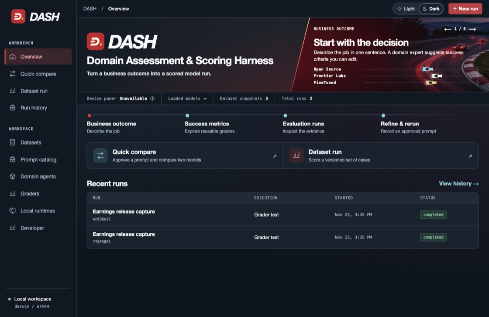

# DASH

**Domain Assessment & Scoring Harness** is a local-first Electron workbench for evaluating model and agent outputs against a business objective. Start with a domain scenario, agree on what a good answer looks like, then compare candidates on the same evidence. The first domain packs cover financial earnings extraction and manufacturing inspection triage.



## Run it locally

Install Node.js 22.13 or later and npm. The desktop application has been exercised on Apple Silicon macOS. Dependency installation needs an internet connection. The recorded example runs offline.

```sh
git clone https://github.com/niksacdev/dash.git
cd dash/dash-desktop
npm ci
npm start
```

On macOS, you can also open `Open DASH.command` after installing dependencies. Switch **Light / Dark** beside **New run**. Your choice is saved on this device. [Light appearance](docs/design/overview-light.png)

### First evaluation in five minutes

1. Open **Dataset run** and select **Earnings release capture**. Expand the recorded-response grader test and start it. This scores eight synthetic cases without requiring a model or API key.
2. Open the result for **eps-gaap**. The recorded answer substitutes adjusted EPS for reported GAAP EPS. Compare the candidate output to the held-out reference and inspect the grader’s explanation.
3. For live inference, start the LM Studio local server on port `1234` or Ollama on port `11434`, load a chat model, then use **Local runtimes → Refresh models**. In **Dataset run**, click one or two models onto the starting line and choose **GO**.
4. For **Quick compare**, load an LFM3 chat model for planning. Describe a business objective, such as “Flag incoming parts that exceed the drawing tolerance and cite the measurement.” Choose **Suggest Metrics**, edit the criteria, then draft and approve the prompt. Choose two candidates for the comparison. An OpenAI planning fallback can be configured under **Domain agents**.

### Design graders and inspect scores

Open **Workspace → Graders**, or design graders from a run setup. Give the grader agent an objective and observable metrics. It proposes a set of distinct checks and explains what each measures. Edit the criteria, threshold, and judge, then confirm the checks you want. Confirmation saves reusable versions in the grader library. Confirming from a run attaches those versions to that run.

The Electron application is written in JavaScript. It uses Opik’s TypeScript SDK in the main process for exact matches, substring checks and G-Eval. A G-Eval rubric uses the local judge you select. Scenario-specific JSON-field comparisons and ordered agent-action checks use the corresponding reference or trace. You can grade an existing agent output with its supplied steps in the library. Connecting a hosted agent for live execution is a separate design track. [Agent feasibility review](docs/reviews/agent-runs-feasibility.md)

Inspect per-case scores and explanations in **Run history**. A winner needs complete scores on the same cases and a lead on at least one rubric with no losses on the others. Ties, mixed results and missing evidence are shown explicitly. [Opik evaluator documentation](https://www.comet.com/docs/opik/reference/typescript-sdk/evaluation/metrics)

### Connect an Opik project

The desktop workbench can run offline. To record a finished run as native Opik experiments, configure the destination before starting DASH. For example, with an existing local Opik server:

```sh
DASH_OPIK_API_URL=http://localhost:5173/api OPIK_PROJECT_NAME=DASH npm start
```

For a hosted deployment, set the API URL and `OPIK_WORKSPACE` for your account, and supply `OPIK_API_KEY` through your environment. `DASH_OPIK_UI_URL` can point to your dashboard. **Run history** shows the destination and lets you sync saved inputs, outputs, and scores. Each candidate gets an experiment pinned to the same Opik dataset version. Revisions of an industry/scenario dataset family stay together, including case additions, edits and removals. Syncing a single-case rerun sends the full authored dataset snapshot and the recorded results for the cases actually run. Sync does not repeat inference. [Opik experiment logging](https://www.comet.com/docs/opik/evaluation/advanced/log_experiments_with_rest_api)

## What the Overview measures

| Metric | Source |
| --- | --- |
| Device power | An instantaneous reading for the host running DASH. On supported Macs the AppleSmartBattery SystemLoad sensor reports milliwatts, converted to watts. Hover, focus, or tap for device and sensor details. Unsupported sensors show **Unavailable**. |
| Loaded models | Latest local runtime inventory. LM Studio reports loaded instances and Ollama reports its active models. Downloaded models only count when a runtime confirms they are loaded. |
| Dataset snapshots | Versioned entries in the workspace’s SQLite dataset catalog. |
| Total runs | All saved runs in the workspace, including failed runs and recorded-response tests. |

Run history preserves prompt versions, selected models, grader versions and measured telemetry in the Electron user-data directory. For dataset import, add a family, industry, snapshot version and split. A case can contain a prompt or conversation, an optional reference, an SME rationale and a rubric. Model-visible inputs and held-out evidence are stored separately. [Dataset and runtime guide](docs/guides/workbench.md)

## Development

From `dash-desktop/`:

```sh
npm test
npm run test:desktop
npm run test:workflow
```

The desktop tests run Electron against isolated temporary profiles. The workflow test simulates model transport and exercises the approval, inference, scoring and report paths. Live model quality and hardware power readings depend on the device and runtime.

| Directory or file | Purpose |
| --- | --- |
| [dash-desktop/](dash-desktop/) | Electron app, local orchestration, SQLite storage, scenario packs, and tests |
| [docs/adr/](docs/adr/) | Architecture decisions, trade-offs and ownership boundaries |
| [Documentation index](docs/START_HERE.md) | Workbench guide, specifications, design references, product reviews and original artifacts |
| [CONTRIBUTING.md](.github/CONTRIBUTING.md) | Branch, commit, verification and pull request workflow |

DASH is distributed under the repository’s [MIT license](LICENSE). Included model marks have their own [attribution](dash-desktop/ui/assets/model-logos/LICENSE.txt).
