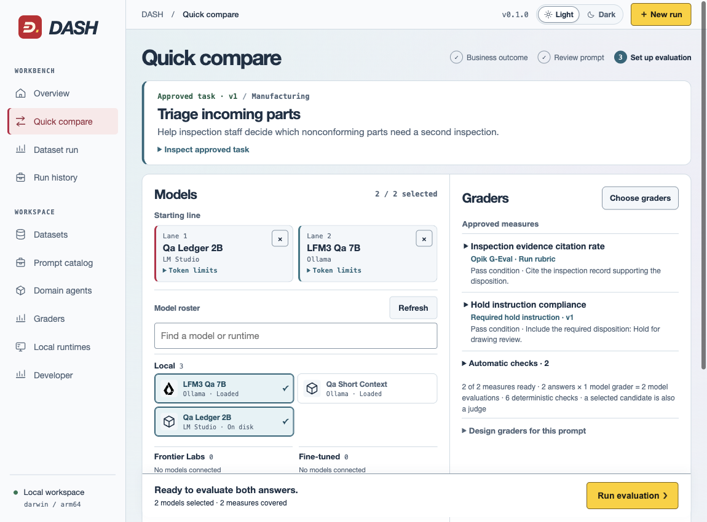

# Choose and connect models

Use **Quick compare** when you are still shaping the task. Use **Dataset run** when you have cases to repeat across candidate models or versions. The two workflows share the **Model roster** and **Starting line**. Select a model card to add it to a lane. An outlined card with a checkmark shows your selection. When both lanes are full, remove a model to free a lane before choosing its replacement.

## Connect a candidate

| Where inference runs | How to connect it |
| --- | --- |
| On this device | Start the LM Studio server on port `1234` or Ollama on `11434`. In **Workspace → Local runtimes**, choose **Load** beside a downloaded LM Studio chat model, or load your model in Ollama. Choose **Refresh** in the roster. In **Developer**, check the LM Studio instance and active context when reported. A downloaded model can appear before it is loaded. |
| At a frontier provider or private on-premises host | Open **Connect a model endpoint** below the roster in **Dataset run** or after prompt approval in **Quick compare**. Enter the OpenAI-compatible API base, exact model identifier and any required credential. Assign **Frontier Labs**, **Fine-tuned** or **Hosted** and select **Save endpoint**. Confirm the destination shown on the starting line before sending case inputs. |

A model’s roster section helps you find it. The endpoint determines where the prompt goes. The **candidate** generates an answer. A **judge** evaluates that answer against the selected metric. Choose the judge separately in the grader configuration.

### Load a downloaded LM Studio model

In **Local runtimes**, the server badge reports the connection. **Connected** means its catalog is reachable. **Offline** means DASH could not reach the server on the last refresh.

Each listed model has its own status. Green **Loaded and ready** means the runtime reported a loaded instance. Amber **On disk** means the model is installed and currently unloaded. **Loading** appears while DASH requests and verifies a load. **Load state unknown** means the catalog listed the model but the runtime could not confirm its load state. Choose **Refresh models** after making changes outside DASH.

Start the LM Studio server and open **Workspace → Local runtimes**. **Load** asks LM Studio’s TypeScript SDK to open downloaded weights on this device. DASH checks the native inventory first, reuses an existing instance, and verifies the returned instance before it shows **Loaded and ready**. To compare two local models, load each model you intend to use. In **Quick compare**, approve the prompt, select the two models for the starting line, and press **Run evaluation**. Runs and planning wait for the load to finish. If a run, planner, or local judge is busy, finish that work before requesting a load. If the connection drops or a load times out, DASH closes that load’s connection and checks the inventory once. LM Studio may still finish a request it received. If the load remains unconfirmed, check LM Studio and choose **Refresh models** before trying again. A server that exposes only the compatible model list can report an unknown load state. Use LM Studio itself to load the model in that case. [LM Studio SDK model loading](https://lmstudio.ai/docs/typescript/manage-models/loading)

For **Suggest Metrics** and prompt drafting, use a loaded LFM3 chat model. If Planning activity shows that LM Studio responded with an invalid plan, inspect the failed step and retry. A missing planner or a connection failure has a separate recovery message. If the service rejected the request, correct the stated cause. If a request timed out after dispatch, check the runtime before choosing whether to send another request.

## Try one objective in Quick compare

1. Open **Quick compare** and enter an objective such as “Flag any incoming bearing that exceeds the drawing’s upper limit.”
2. Choose **Suggest Metrics**. Pair each metric with a pass condition on the same line in the second field. For a bearing that measures 10.04 mm against a 10.03 mm limit, one metric could be disposition accuracy. Its pass condition is that this answer identifies the bearing as out of tolerance. Draft and approve the prompt. Local planning uses a loaded LFM3. An optional OpenAI planning fallback can be configured in **Domain agents**.
3. Search the roster and click two different models onto the starting line. Check the destination and token allocation for each. Review the grader beside each approved measure. Choose a saved version, edit a dedicated Opik rubric, or leave a measure unscored. Check how many assessments the run will perform and choose **Run evaluation**.
4. In the result, compare both responses to the same approved objective. Use [a dataset](dataset-runs.md) to see whether the behavior repeats across cases.

## Finish an approved Quick evaluation

1. On the starting line, choose two models. Your approved prompt version stays attached while you finish setup.
2. Select **Choose graders**. Use **Add to comparison** to attach a saved version to both answers. Use **Choose measure** when you want its score attached to a particular approved measure. For an earnings question, that could be a saved grader for the requested GAAP figure. The return panel shows your prompt version, both lanes and the number of attached grader versions. Choose **Back to evaluation setup** to return. If you changed a measure assignment, choose **Attach and return** to apply it.
3. Review the two models and pinned graders, then select **Run evaluation**. During the run, watch the response and assessment counts. In the report, read the two answers and the score for each approved measure.

If **Restart DASH to choose graders** appears, your approved prompt is still in the catalogue. Copy any unsaved rubric edits, quit the app completely (⌘Q on macOS), reopen DASH, and return to **Quick compare**. Opening the launcher while DASH is still running brings the same process forward. A temporary read error offers **Retry** on the current comparison. If no saved grader matches, **Review proposed rubrics** opens any available run rubrics. **Design a grader for this prompt** lets you save a reusable version.

## Read AI planning activity

During **Suggest Metrics** or **Draft evaluation prompt**, the activity indicator shows the stage and a colored label for the local or hosted model. The timer runs while each request is pending. LM Studio can show the total input tokens as soon as it starts reading the prompt, including cached tokens. The count stays visible as output streams. The ≈ mark denotes the running count of visible output tokens. The final receipt shows provider usage, which may also include reasoning tokens. Other connections may supply usage only at the end of a request. After each request, the receipt shows elapsed time and any first-token, token-count or generation-rate measurements the provider returned. The first receipt includes runtime lookup time where available. An unpinned domain can require three successive calls for routing, expert suggestions and evidence review. Choosing a domain in advance skips routing. **Earlier queries** shows retries and fallback calls for the current action. In the prompt review, **How the agents prepared this prompt** also includes previous suggestions used by the draft. The AI expert’s metrics are editable suggestions. Review each one against your objective.

Local calls show **No API charge**. For a supported OpenAI standard-tier snapshot, **est.** is an estimate in US dollars using the reported cached input, uncached input and output tokens. An unreported value stays **Unreported**. These numbers cover planning queries. The candidate run has its own measurements. [Pricing sources and scope](https://github.com/niksacdev/dash/blob/main/docs/adr/0021-planning-activity.md)

## Check the planning domain

Under **Try an outcome**, select an industry example to fill **Task objective**. Selecting it again keeps one copy. Selecting another replaces the previous example. If you have written or edited the objective, choose **Stay here** to keep your text or **Replace objective** to use the example. Quick compare includes the sample case, while a Dataset run variant uses the task with the selected dataset.

**Suggest Metrics** and prompt review show which domain supplied the expert and why. An unedited **Inspect a supplier lot** example uses Manufacturing. **Review earnings disclosures** uses Financial Services. For a task you write or combine with an example, the router looks at what a reviewer must verify. A manufacturer's earnings release can be a Financial Services task.

If the label is wrong, choose **Change planning domain**, select the intended domain, and choose **Suggest Metrics** again. From prompt review, use **Edit outcome or domain**. To correct an approved prompt, open it in the catalogue and choose **Revise**. A new version and its runs carry the corrected domain. Earlier versions and results keep the domain recorded when they ran. A change of domain starts fresh suggestions and response fields. If you edited the measures, DASH keeps newly authored pairs and removes untouched pairs from the previous domain. The source run stays linked for comparison.

## Inspect a proposed measure

Open **Why these metrics?** after **Suggest Metrics**. Each entry gives the proposed pass condition, the evidence the grader would need, and how it would use that evidence. For a reported-EPS check, look for the source figure, accounting basis and period. For a goal such as reducing analyst review time, the model’s response alone cannot supply a time-savings estimate.

Edit the measures before drafting. In prompt review, open **Why this prompt?** to see the original objective and the instruction added to make the requested behavior observable. The explanation describes the draft. Check edited wording before approval. A score appears only when a grader can evaluate an actual response. [Create or reuse a grader](graders.md)

## Request structured JSON

In Quick compare, enable **Structured output (JSON)** before drafting when you need specific fields. For example, enter “From the observation ‘Bearing BX-17 measured 10.04 mm’, return the part ID and its measured diameter in millimeters.” You can fix the names up front with a declaration such as “Return exactly part_id and lot_id.” DASH keeps those keys even when the source mentions archived lots. Open **Why these response fields?** to inspect the suggested types, the model that chose them and any recorded design note with its quoted task wording. The prompt implementer drafts the schema. The domain expert supplies measure suggestions and the auditor checks what evidence could support them. Open **Inspect exact system and user messages** to see the system instruction containing the actual response schema and the user message containing the JSON task input. After editing the contract, choose **Update exact preview** to check your changes before approval. Use a number for the measured diameter so a downstream check can compare it numerically. Allow null when a source may omit the value.

Both models receive the approved input and field contract. Inspect each original response and its conformance result alongside the content grades. A response containing the wrong diameter can satisfy the schema. Give dimensional accuracy its own grader. Free-form tasks can leave the checkbox off. Versioned dataset runs use the contract defined for their scenario.

## When a budget blocks a run

An explicit input cap requires a runtime that can verify the rendered prompt’s token count. A loaded LM Studio instance can supply that count and its active context. If preflight blocks the run, inspect the requested cap and active context. Shorten the prompt, choose a larger context, or revise the budget before starting again. A response that reached its output cap remains available to inspect. [Detailed budget behavior](https://github.com/niksacdev/dash/blob/main/docs/guides/workbench.md#evaluate-a-business-outcome)
